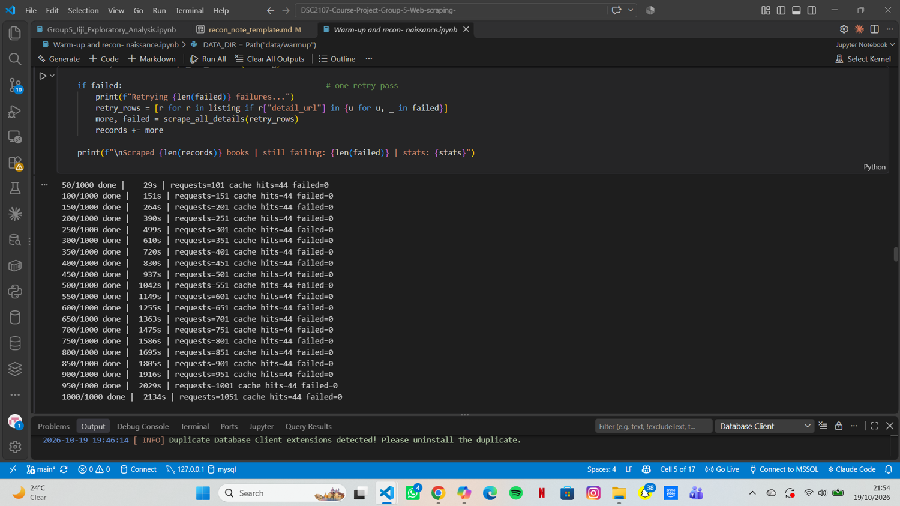

# Reconnaissance Note: Jiji Uganda (jiji.ug)
**Course:** DSC2107 Data Mining & Wrangling | **Group:5** ____ | **Date:13/10/2026** ____ |
 **Members:1.WANDWASI KEVIN JOEL** 
         **2.NDAMBIRE HARRY BOSCO**
         **3.AGABA JONATHAN** 
         **4.MUSIIME MIRACLE** 
         **5.NAKITTO FAVOUR** 


## 1. Site assignment
Assigned site per brief: Group 5 = Jiji Uganda (jiji.ug). 

## 2. robots.txt findings
```
# AI/LLM information about this site: /llms.txt (Provides information intended to help AI systems and large language models understand the website.)

User-agent:DSC2107-Course-Project (Group 5, B32912@students.ucu.ac.ug) *
Disallow: /test/*        (Restricts crawling of pages and resources under the /test/ directory)
Disallow: /admin/*       (Restricts crawling of pages under the /admin/ directory.)
Disallow: /crm/*         (Restricts crawling of pages under the /crm/ directory)
Disallow: /auth/facebook*(Restricts crawling of URLs beginning with /auth/facebook)

User-agent: Bingbot
Disallow: /profile       (Blocks URLs beginning with /profile.)
Disallow: /sc/           (Blocks pages and resources under the /sc/ directory.)
Disallow: /*?*query=     (Blocks URLs containing a query parameter named query)
Disallow: /*?*period=    (Blocks URLs containing a period query parameter)
Disallow: /*?*sort=      (Blocks URLs containing a sort query parameter)
Disallow: /test/*        (Blocks the test directory)
Disallow: /admin/*       (Blocks the admin directory)
Disallow: /crm/*         (Blocks the CRM directory)
Disallow: /auth/facebook*(Blocks Facebook authentication endpoints.)

```
| Path | Allowed? | Notes |
|---|---|---|
| /mobile-phones |Yes | Not explicitly disallowed in robots.txt; Bingbot and general crawlers may crawl it.|
| /tablets |Yes |Not explicitly disallowed; crawling is permitted under the listed rules. |
| /smart-watches | Yes|Not explicitly disallowed; crawling is permitted under the listed rules. |
| pagination parameter |Depends |Bingbot is disallowed from crawling URLs containing query, period, or sort parameters. Other pagination parameters are not explicitly blocked by the shown rules. |
Crawl-delay stated: Not specified (our delay: 2-5 s regardless)

## 3. Site structure
- URL pattern of listings: `/{area}/{category}/{title-slug}-{ID}.html?indexPosition=N`
- Category hierarchy used and approx. number of ads: /mobile-phones ~15,154; /tablets ~2,577; /smart-watches ____ (record the date of these counts)
- Cards per page: ~20 (verify) ; pagination mechanism: ______
- Card order in the HTML is column-by-column, so rank = `indexPosition`, not DOM order 
- Fields on the card: title / price ("USh 450,000") / condition / location ("Region, Area") / seller badges (NOT collected) / description (NOT collected: may contain phone numbers) / discount badge + old price on a few ads: ______
- Posting date found on: card / detail page / not found: ______

## 4. Network analysis (screenshots attached)
- Fetch/XHR calls when loading a category page: ______
- Is listing data in the HTML, in embedded JSON, or from a JSON endpoint? 
They’re injected via Nuxt JSON hydration + API calls.______
- Does plain `requests` return the data?
A plain requests call won’t give you product data unless you extract the embedded JSON or replicate the API request.     ______

## 5. Chosen approach and justification
Approach (requests+BeautifulSoup / embedded JSON / Playwright): ______
Why: ______ (speed, politeness, simplicity, no login/token needed, no circumvention)

Speed: No need to spin up a headless browser (Playwright/Selenium). Parsing JSON is faster.

Politeness: You’re only making one lightweight request per page, not hammering the site with dozens of resource calls.

Simplicity: The JSON already contains the structured data you want, so you avoid messy HTML parsing.

No login/token needed: Jiji’s category pages expose listings in the embedded JSON without requiring authentication.

No circumvention: You’re not bypassing protections or scraping hidden APIs — just reading what’s already delivered to the browser.

## 6. Field map
| Required field | Source | Selector / location | Issues |
|---|---|---|---|
| title |Product card |.b-listing-card__title | Straightforward, usually clean text.|
| price |Product card |.b-listing-card__price | Sometimes accompanied by discount badge + old price; need to normalize.|
| condition |	Product card|.b-listing-card__condition | Consistently present (“New”, “Used”), but may vary in wording.|
| location |	Product card | .b-listing-card__location| Format is "Region, Area"; parsing may be needed if you want separate fields.|
| posting date |Product card + detail page |.b-listing-card__date (list view) or .b-ad__posted-date (detail view) |Occasionally missing on promoted ads; format varies (“Today”, “2 days ago”, full timestamp). |

## 7. Request budget per run
Listing pages ~__ + cohort re-checks ~__ = ~__ requests (cap ~1,000; code stops at 950).

## 8. Ethical safeguards
User-Agent, delays, no logins, excluded personal data (seller names, phones, badges, descriptions),
stop-on-block policy.

User‑Agent string:  
Always send a clear, non‑misleading User‑Agent . This signals that your scraper is automated and avoids pretending to be a normal browser.

Delays between requests:  
Insert short randomized sleeps (e.g., 1–3 seconds) between requests. This reduces server load and avoids hammering Jiji’s infrastructure.

No logins or tokens:  
Only scrape publicly available category pages. Do not attempt to bypass authentication, paywalls, or private seller dashboards.


Excluded personal data:  
Explicitly skip fields that could expose sensitive information:

Seller names

Phone numbers

Seller badges

Free‑text descriptions (since they may contain personal contact info)

Stop‑on‑block policy:  

The scraper must stop immediately if the website returns a CAPTCHA, HTTP 403 (Forbidden), HTTP 429 (Too Many Requests), or another clear blocking signal. No automatic retries, proxy rotation, CAPTCHA-solving, or other attempts to circumvent the restriction are permitted. The scraper should log the event, record the affected URL and response status where available, and terminate the scraping run safely. Data collection may resume only after the cause has been reviewed and the approach is confirmed to comply with the website's terms and applicable access restrictions.
